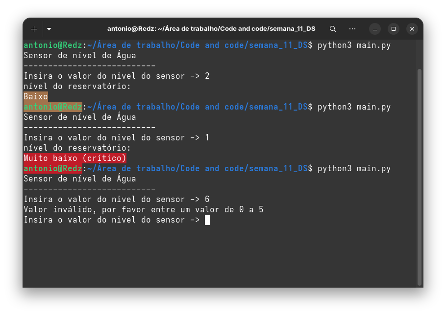

<p align="center">
  
</p>

<h1 align="center">Agenda 11 · Desenvolvimento de Sistemas I</h1>

<p align="center">
  <a href="https://www.python.org/">
    
  </a>
  
  
</p>

---

## 👤 Identificação

| Campo               | Informação                      |
|---------------------|---------------------------------|
| **Aluno**           | Antonio Wenceslau de Freitas    |
| **Cód. cadastro**   | SP20AO0206046                   |
| **Disciplina**      | Desenvolvimento de Sistemas I   |
| **Atividade**       | Agenda 11                       |

---

## 📋 Sobre a atividade

### Controle de Níveis de Água

Você foi contratado para auxiliar no desenvolvimento de um sistema simples de monitoramento de um reservatório de água.

O sistema é executado no **terminal** e exibe mensagens de alerta com **cores diferentes**, de acordo com o nível de água do reservatório. Para destacar visualmente cada situação, utiliza-se a biblioteca [`colorama`](https://pypi.org/project/colorama/).

O sistema trabalha com **cinco níveis**, armazenados em uma lista, do mais baixo até o máximo. Cada nível está associado a uma mensagem de alerta e a uma cor, seguindo a progressão de risco:

| Nível | Situação                  | Cor      |
|:-----:|---------------------------|----------|
| 1     | Muito baixo (crítico)     | 🔴 Vermelho |
| 2     | Baixo                     | 🟡 Amarelo  |
| 3     | Médio                     | 🟢 Verde    |
| 4     | Alto                      | 🔵 Ciano    |
| 5     | Muito alto (alerta)       | 🔷 Azul     |

---

## ✅ Requisitos do programa

- [x] Utilizar uma **lista** para armazenar os níveis ou as mensagens do reservatório
- [x] Importar e utilizar a biblioteca **colorama**
- [x] Criar uma **função** que define a cor da mensagem conforme o nível informado
- [x] Exibir no terminal a situação atual do reservatório com a cor correspondente
- [x] Restaurar o estilo padrão do terminal após a exibição das mensagens

---

## 🛠️ Tecnologias utilizadas

- [Python 3.12.3](https://www.python.org/)
- [Colorama](https://pypi.org/project/colorama/)

---

## 🚀 Como executar

1. **Clone o repositório**
```bash
   git clone https://github.com/antoniowf/semana_11_DS
   cd /semana_11_DS
```

2. **Instale a dependência**
```bash
   pip install colorama
```

3. **Execute o programa**
```bash
   python main.py
```


## 🖥️ Resultado

<p align="center">
  
</p>

---

## 📁 Estrutura do projeto

```
.
├── images/
│   ├── logo.png
│   └── img.png
├── main.py
└── README.md
```
